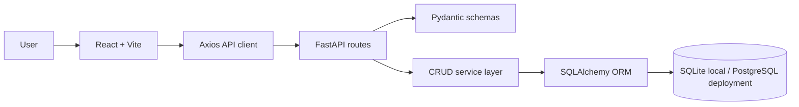

# Architecture Overview

FinanceFlow AI is organized as a React single-page application, a FastAPI REST API, and a relational database accessed through SQLAlchemy.

## Frontend routing and page composition

The current frontend is a single-page React application. Page selection and navigation are managed inside the main `App.jsx` component rather than by a dedicated URL router. This keeps the training build lightweight, but browser-history routing and deep links are not yet implemented. A future iteration can introduce React Router and move each page into its own feature folder.

## Backend request lifecycle

1. A browser action triggers a page-level API function.
2. The shared Axios client adds the configured API base URL and timeout.
3. FastAPI matches the route and validates query parameters or the request body.
4. The route uses a SQLAlchemy session supplied by `get_db`.
5. CRUD helpers perform database operations and commit changes.
6. Pydantic response models serialize database objects.
7. Axios resolves the response or converts API/network errors into a readable JavaScript error.

## Current design boundaries

- The UI workspace selector is not an authorization boundary.
- Authentication and tenant-level access control are not present.
- Financial summaries should be computed from persisted records in deterministic application code.
- Schema creation at application startup is for local learning only; production deployments should use versioned migrations.
