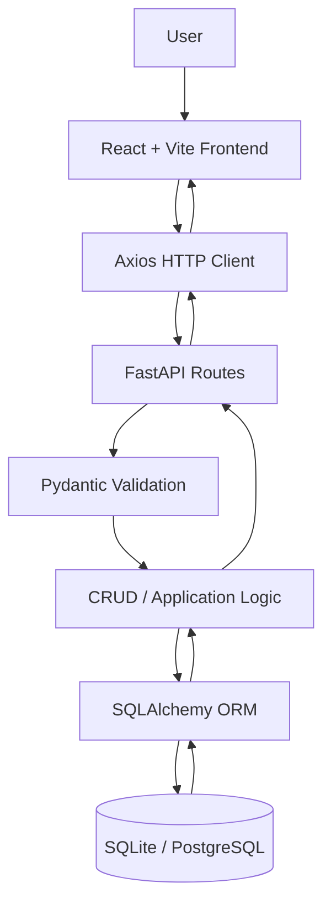

# FinanceFlow AI

> A Python full-stack financial management application for individuals and small businesses.

FinanceFlow AI brings everyday financial record-keeping into one application. It provides a central place to manage transactions, budgets, categories, customers, and suppliers, with a dashboard for reviewing financial activity.

---

## Table of Contents

- [Project Overview](#project-overview)
- [Problem Statement](#problem-statement)
- [Target Users](#target-users)
- [Features](#features)
- [Technology Stack](#technology-stack)
- [System Architecture](#system-architecture)
- [Request and Data Flow](#request-and-data-flow)
- [Project Structure](#project-structure)
- [Getting Started](#getting-started)
- [Configuration](#configuration)
- [Running the Application](#running-the-application)
- [API Documentation](#api-documentation)
- [Testing and Quality Checks](#testing-and-quality-checks)
- [Deployment Preparation](#deployment-preparation)
- [Known Limitations](#known-limitations)
- [Roadmap](#roadmap)
- [Development Workflow](#development-workflow)

---

## Project Overview

FinanceFlow AI is designed to make financial activity easier to record, organize, and review. The application combines a React-based user interface with a FastAPI backend and a relational database.

The project is developed as a full-stack application, with an emphasis on clear separation between the frontend, API layer, validation, database models, and persistence logic.

## Problem Statement

Individuals and small business owners may keep track of income, expenses, budgets, customer credit, and supplier dues using notebooks or disconnected tools. This can make it harder to find historical records, review spending, and maintain a consistent view of financial activity.

FinanceFlow AI aims to provide a centralized digital workspace for managing these records.

## Target Users

- **Individuals** who want to organize income, expenses, and budgets.
- **Small retailers** who need to maintain transaction, customer, and supplier records.
- **Small business owners** who want a consolidated view of routine financial activity.

## Features

### Dashboard and financial overview
- Dashboard for reviewing key financial information.
- Summary views based on the records available in the application.

### Transaction management
- Create, view, update, and delete transactions.
- Search and filter transaction records.
- Sort records by supported fields.
- Export transaction data to CSV where available.

### Budget and category management
- Create and manage budgets.
- Organize transactions using categories.
- Review budget information and utilization views.

### Customer and supplier management
- Maintain customer records.
- Maintain supplier records.
- Organize business-related contact information.

### Application experience
- Responsive React interface.
- Shared navigation and reusable UI elements.
- Loading, empty, success, and error feedback in supported workflows.
- Axios-based communication with the backend.

> **Scope note:** Feature availability can vary by project version. Confirm each workflow in the running application before presenting it as fully verified.

## Technology Stack

| Layer | Technology | Responsibility |
|---|---|---|
| Frontend | React, Vite, JavaScript, CSS | User interface and client-side interactions |
| HTTP client | Axios | Frontend-to-backend HTTP communication |
| Backend | Python, FastAPI | REST API and request handling |
| Validation | Pydantic | Request and response data validation |
| ORM | SQLAlchemy | Relational database access |
| Database | SQLite / PostgreSQL configuration | Persistent application data |
| Testing | Pytest | Automated backend tests |
| API specification | OpenAPI | Machine-readable API description |
| Deployment preparation | Docker, Docker Compose, Nginx | Container and web-server configuration |
| CI preparation | GitHub Actions | Automated workflow configuration |

## System Architecture



### Architecture responsibilities

1. **React frontend:** Renders pages, collects user input, and displays API results.
2. **Axios client:** Sends HTTP requests and receives JSON responses.
3. **FastAPI:** Exposes API endpoints and coordinates request handling.
4. **Pydantic:** Validates incoming data and structures API schemas.
5. **Application logic:** Executes create, read, update, delete, and query operations.
6. **SQLAlchemy:** Maps Python models to relational database operations.
7. **Database:** Persists application records.

## Request and Data Flow

A typical transaction creation flow works as follows:

1. A user fills out the transaction form in the React application.
2. The frontend sends the form data through Axios.
3. FastAPI receives the HTTP request at the relevant route.
4. Pydantic validates the request payload.
5. Backend logic uses SQLAlchemy to write the record to the database.
6. FastAPI returns a JSON response and an appropriate HTTP status code.
7. React updates the interface and displays the result to the user.

## Project Structure

The backend is organized by application responsibility, while the frontend contains the React application and its reusable UI code. The exact filenames may differ between project revisions.

```text
FinanceFlow-AI/
├── backend/
│   ├── app/
│   │   ├── main.py
│   │   ├── models/
│   │   ├── schemas/
│   │   ├── routes/
│   │   ├── services/       # or CRUD/application logic, by project revision
│   │   └── ...
│   ├── tests/
│   ├── requirements.txt
│   └── .env.example
├── frontend/
│   ├── src/
│   │   ├── components/
│   │   ├── pages/
│   │   ├── ...
│   ├── package.json
│   └── ...
├── docs/
│   ├── API_DOCUMENTATION.md
│   └── BUG_LOG.md
├── docker-compose.yml      # if included in the checked-out revision
└── README.md
```

## Getting Started

### Prerequisites

Install the following tools:

- Python 3.10 or newer (use the version supported by the project's dependencies).
- Node.js and npm.
- Git.
- SQLite for the default local setup, or PostgreSQL if configured.

Docker is optional for local development unless you choose to use the container configuration.

### 1. Clone the repository

```bash
git clone <YOUR_GITHUB_REPOSITORY_URL>
cd FinanceFlow-AI
```

Replace `<YOUR_GITHUB_REPOSITORY_URL>` with the actual repository URL.

### 2. Set up the backend

Open a terminal in the backend directory:

```bash
cd backend

python -m venv .venv
```

Activate the virtual environment.

**Windows Command Prompt:**
```cmd
.venv\Scripts\activate
```

**Windows PowerShell:**
```powershell
.\.venv\Scripts\Activate.ps1
```

**macOS / Linux:**
```bash
source .venv/bin/activate
```

Install dependencies:

```bash
python -m pip install --upgrade pip
pip install -r requirements.txt
```

If the project includes `.env.example`, create a local environment file.

**Windows Command Prompt:**
```cmd
copy .env.example .env
```

**macOS / Linux:**
```bash
cp .env.example .env
```

Review `.env` and set values appropriate for your local environment. Do not commit secrets.

### 3. Set up the frontend

Open a second terminal:

```bash
cd frontend
npm install
```

## Running the Application

### Start the backend

From the `backend` directory, with the virtual environment activated:

```bash
python -m uvicorn app.main:app --reload
```

The backend is commonly available at:

- API base: `http://localhost:8000`
- Interactive API documentation: `http://localhost:8000/docs`
- Alternative API documentation: `http://localhost:8000/redoc`

These addresses assume the default Uvicorn host and port.

### Start the frontend

From the `frontend` directory:

```bash
npm run dev
```

Open the local URL printed by Vite in your terminal. Ensure the frontend API base URL points to the backend address configured for your environment.

## Configuration

Use the environment example supplied with the project as the source of truth for supported settings.

Typical configuration concerns include:

- Database connection URL.
- API host and port.
- Frontend API base URL.
- CORS allowed origins.
- Environment mode.

Do not paste production credentials, tokens, or private connection strings into source control. If a setting is not present in the checked-out `.env.example`, do not assume the application supports it without adding and testing the configuration.

## API Documentation

FastAPI generates an OpenAPI specification from the registered routes and schemas.

When the backend is running, open:

```text
http://localhost:8000/docs
```

Use the interactive documentation to inspect available endpoints, request schemas, response schemas, and status codes.

The API commonly groups operations around resources such as:

- Transactions
- Categories
- Budgets
- Customers
- Suppliers
- Health checks

The exact route paths and supported methods are defined by the backend code and generated OpenAPI document. Refer to those sources rather than relying on guessed endpoint URLs.

## Testing and Quality Checks

### Backend tests

From the backend directory:

```bash
python -m pytest -q
```

Run the tests before committing backend changes. A passing test suite is evidence for the cases covered by those tests; it does not prove that every application workflow is bug-free.

### Frontend production build

From the frontend directory:

```bash
npm install
npm run build
```

If the project defines a lint or test script, run it using the matching command shown in `frontend/package.json`.

### Manual application checks

Before a demonstration or release, verify:

- Dashboard loads without unexpected errors.
- Transaction create, view, update, and delete workflows.
- Transaction search, filters, sorting, and CSV export, if enabled.
- Budget and category workflows.
- Customer and supplier workflows.
- Validation messages for invalid form input.
- Loading, empty, and error states.
- Responsive layout and navigation.
- Frontend-to-backend connectivity.

Record defects and their reproduction steps in the project's bug log.

## Deployment Preparation

The project may include Dockerfiles, Docker Compose, Nginx configuration, and a GitHub Actions workflow for deployment preparation and automated checks.

Before using these configurations for a real deployment:

1. Review the Docker build contexts and environment variables.
2. Configure a production database and run database migrations.
3. Set secure secrets outside the repository.
4. Configure allowed origins and HTTPS.
5. Verify Nginx routing and API proxy behavior.
6. Run backend tests and the frontend production build.
7. Test the deployed application using non-production data first.
8. Configure backups, logs, monitoring, and an operational recovery plan.

Deployment configuration being present in the repository does not by itself mean the application has been deployed or production-validated.

## Known Limitations

The following items should be checked against the current implementation and treated as future work unless they have been implemented and tested:

- Secure user authentication and authorization.
- Workspace-level data isolation for multiple users or businesses.
- Alembic-based database migrations.
- Auditable ledger entries as the source of truth for customer and supplier balances.
- Production monitoring, backup, and recovery procedures.
- Additional integration and end-to-end tests.
- AI-generated insights connected to authorized data and deterministic financial calculations.

Financial totals and balances should be computed by deterministic backend logic. An AI assistant, if added, should not invent or independently calculate authoritative financial figures.

## Roadmap

- [ ] Complete final regression testing across all modules.
- [ ] Add authentication and role-based authorization.
- [ ] Add workspace-level tenant isolation.
- [ ] Introduce Alembic migrations.
- [ ] Implement ledger-based customer and supplier balances.
- [ ] Expand automated API and frontend tests.
- [ ] Add production monitoring and backup procedures.
- [ ] Extend AI-assisted insights with controlled, read-only access to verified financial data.

## Development Workflow

A suggested workflow for contributors:

1. Create a focused branch for the change.
2. Make the smallest clear implementation that solves the task.
3. Add or update tests for the behavior.
4. Run backend tests and frontend checks.
5. Review the diff for secrets, debug code, and unrelated changes.
6. Update documentation when behavior or configuration changes.
7. Commit with a descriptive message and open a pull request.

Example:

```bash
git checkout -b feature/transaction-improvements
git add .
git commit -m "Improve transaction management"
git push -u origin feature/transaction-improvements
```

---

## Project Status

**Project:** FinanceFlow AI  
**Type:** Python Full-Stack Financial Management Application  
**Purpose:** Internship / learning project and demonstration of full-stack engineering concepts

For evaluation, use the checked-out repository, passing test output, API documentation, and a live demonstration as evidence of the current implementation status.

---

*Built as a full-stack learning project. Review the security, data integrity, and deployment requirements carefully before using real financial or customer data.*
